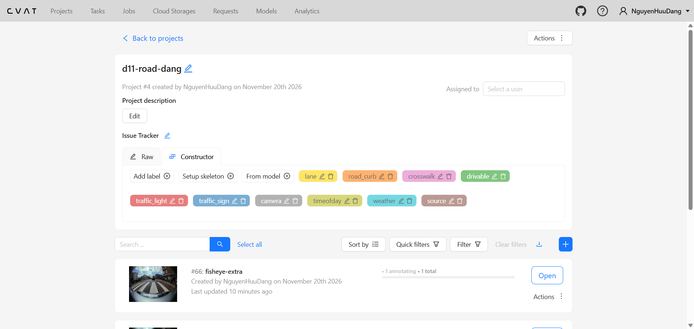
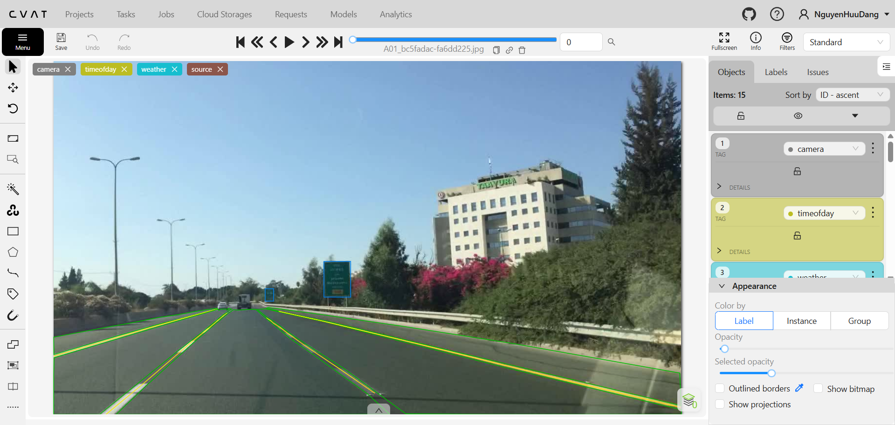
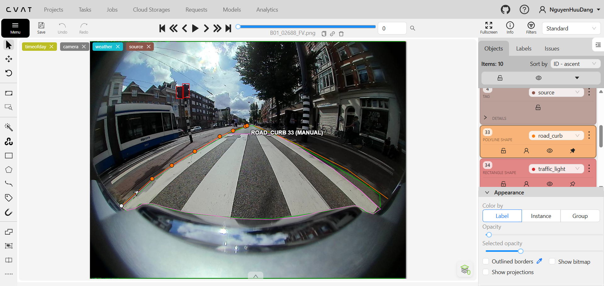

# Báo cáo cá nhân — Ngày 11

Họ tên: Nguyễn Hữu Đăng               Mã học viên: 2A202603300
Phiên bản CVAT (Help → About): CVAT local (`localhost:8080`)
Guideline: Road v1.0    Lần nộp (`revision` trong manifest): 1
Thời điểm export (ngày giờ trên CVAT): 20/11/2026 23:09    Số lần nộp lại sau Rework: 0

## 1. Kiểm project

| Mục                       | Đúng như guideline Road v1.0? | Ghi chú                                                                                                                   |
| -------------------------- | -------------------------------- | -------------------------------------------------------------------------------------------------------------------------- |
| 6 label, đúng kiểu      | Đúng                           | `lane`, `road_curb` (polyline); `crosswalk`, `drivable` (polygon); `traffic_light`, `traffic_sign` (rectangle) |
| Thuộc tính và giá trị | Đúng                           | Khớp `configs/road_v1_labels.json`                                                                                      |
| 4 tag ảnh                 | Đúng                           | `camera`, `timeofday`, `weather`, `source` (mỗi tag có thuộc tính select `value`)                            |

Cách kết thúc polyline trên bản CVAT này: Bấm phím `N` (hoặc nhấp đúp chuột trái ở điểm cuối).
Cách đặt tag ảnh trên bản CVAT này: Chọn công cụ **Tag** ở thanh bên trái, chọn label tag rồi mở **Details** chỉnh `value`.

## 2. Số lượng đã gán

| Task                            | Ảnh | lane | road_curb | crosswalk | drivable | traffic_light | traffic_sign |
| ------------------------------- | ---: | ---: | --------: | --------: | -------: | ------------: | -----------: |
| front                           |   12 |   33 |        10 |         5 |       31 |            26 |           28 |
| front-extra (đã làm 4 / 4)   |    4 |   11 |         4 |         5 |       10 |             8 |           16 |
| fisheye                         |    8 |    9 |        12 |         7 |       10 |             8 |            5 |
| fisheye-extra (đã làm 4 / 4) |    4 |    0 |         1 |         5 |        4 |             0 |            2 |

## 3. Bảng ca khó

| Ảnh | Nhãn    | Phân vân giữa                               | Đã chọn                   | Lý do                                                                                                                                          |
| ---- | -------- | ---------------------------------------------- | ---------------------------- | ----------------------------------------------------------------------------------------------------------------------------------------------- |
| A05  | `lane` | Có vẽ L1/R1 hay không                       | Không vẽ `L1`, `R1`    | Mặt đường hoàn toàn không có vạch sơn, hai bên là xe đỗ sát vỉa hè (**coach đã xác nhận miễn `QC1-02`**)                             |
| A07  | `lane` | Vạch ngang chữ T/L nối từ `R1` ra `R2` | Bỏ qua, không vẽ `lane` | Là vạch ngang chia ô/vùng đệm, Road v1.0 chỉ gán vạch dọc phân làn                                                                  |
| A08  | `lane` | Vẽ `L1` bên trái hay không               | Không vẽ `L1`            | Bên trái làn đang đi thực tế không có vạch sơn (vạch trắng ngoài cùng thuộc làn ngược chiều); thuộc diện miễn `QC1-02` |
| A14  | `lane` | Vẽ `R1` bên phải hay không               | Không vẽ `R1`            | Bên phải sát vỉa hè chỉ có `road_curb`, không có vạch sơn (**coach đã xác nhận miễn `QC1-02`**)                                           |

## 4. Phiếu QC 1 nhận được

Bạn kiểm lô của tôi: Bạch Đăng Ngọc Tuấn-2A202603314   Quyết định nhận được: Release

*(Các lỗi đã tự phát hiện và sửa trước khi nộp bằng `road_check lint`:)*

| Mã lỗi                                                                                                        | Số lỗi | Đồng ý? | Đã sửa?          |
| --------------------------------------------------------------------------------------------------------------- | -------: | ---------- | ------------------- |
| QC1-01 (sai/thiếu tag `camera` trên `B04`, `B05`, `B06`, `B07`, `B08`, `B10`, `B11`, `B12`) |        8 | Có        | Đã sửa toàn bộ |
| QC1-03 (thiếu `position = other` trên `B05`, `B06`, `B07`, `B08`)                                   |        5 | Có        | Đã sửa toàn bộ |
| QC1-05 (tách/trùng `R1` trên `A08`)                                                                      |        1 | Có        | Đã sửa           |
| QC1-11 (`edge_zone` trên `B02`)                                                                            |        4 | Có        | Đã sửa           |

## 5. Kiểm file export

| File                 | Mở lại được?                       | Số shape ảnh 1 (job / file) | Số shape ảnh 2 (job / file) | Tag camera có trong XML? |
| -------------------- | --------------------------------------- | ----------------------------- | ----------------------------- | ------------------------- |
| `dang-front.zip`   | Có (`road_check lint` đọc được) | 11 / 11 (`A01`)             | 7 / 7 (`A02`)               | Có (`front`)           |
| `dang-fisheye.zip` | Có (`road_check lint` đọc được) | 6 / 6 (`B01`)               | 8 / 8 (`B02`)               | Có (`fisheye_front`)   |

## 6. Ảnh chụp màn hình

1. Tab Labels của project:



2. Một ảnh camera trước đã gán đủ (làn, vùng lái, đèn/biển — `A01`):



3. Một ảnh fisheye đã gán, phóng to đoạn polyline cong (`B01`):



4. Một đoạn XML có `<polyline label="lane">` (trích từ `A01` trong `dang-front.zip`):

```xml
<polyline label="lane" source="manual" occluded="0" points="654.87,676.94;581.97,626.57;510.40,578.19;475.94,553.67;461.36,542.41;448.10,533.92;442.54,528.76;433.59,523.26" z_order="0">
  <attribute name="position">R1</attribute>
  <attribute name="style">solid</attribute>
  <attribute name="color">white</attribute>
  <attribute name="kind">single</attribute>
</polyline>
```

## 7. Tự đánh giá

- **Lỗi mắc nhiều nhất hôm nay (theo mã QC1-xx), và cách tránh ở Ngày 20**:
  Mắc nhiều nhất là **`QC1-01`** (quên đổi tag `camera` hoặc nhầm `fisheye_left` / `fisheye_right`) và **`QC1-03`** (quên đổi `position` mặc định `L1` sang `other` ở camera fisheye hai bên `MVL`/`MVR`). Cách tránh ở Ngày 20: luôn gắn đủ 4 tag ngay khi mở ảnh, đối chiếu hậu tố `FV/RV/MVL/MVR` trước khi chuyển ảnh, và kiểm tra lại Details ngay sau khi vẽ xong từng polyline.
- **Nhãn của bạn đi vào model ở đâu? Chọn một lỗi đã sửa và nói nó làm model học sai thế nào**:
  Nhãn `lane` (tâm vạch + `position`) đi vào làm ground truth cho bài toán phát hiện làn đường (lane detection / LKA), còn tag `camera` dùng để phân nhóm góc nhìn khi huấn luyện/đánh giá. Nếu giữ lỗi `QC1-03` (để nhầm `position = L1` cho vạch trên camera bên hông `MVL/MVR` thay vì `other`), model sẽ học sai khái niệm làn xe đang đi (`ego lane`), dẫn đến dự đoán lệch làn khi chạy thực tế.

## 8. (Tùy chọn, buffer) Từ polyline đến đích row-anchor

*(Phần tùy chọn, không tính điểm.)*
